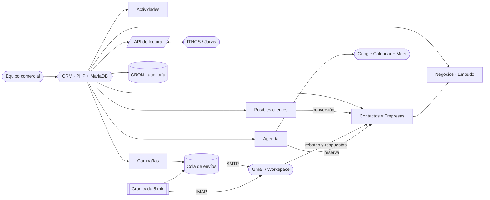
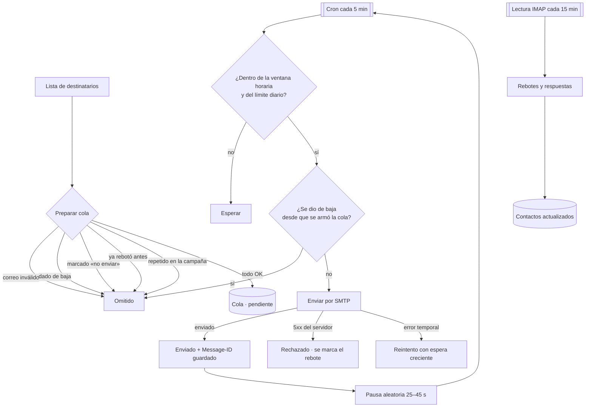
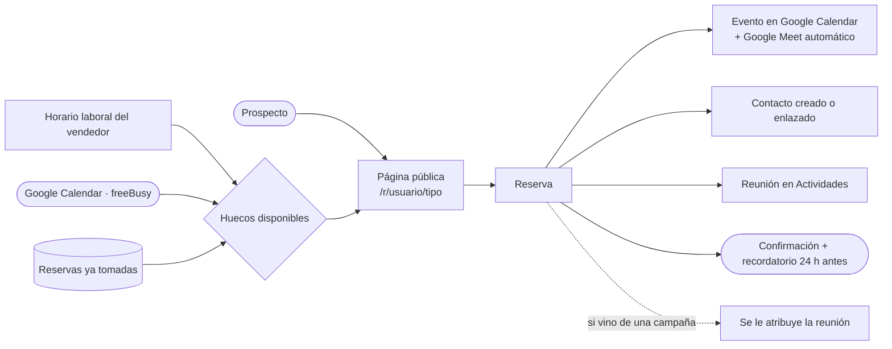

<p align="center">
  
</p>

<p align="center">
  <b>CRM comercial propio: base de contactos, embudo de ventas, campañas de correo en frío y agenda de reuniones con Google Meet.</b><br>
  Reemplaza a Zoho CRM y absorbe el motor de envío de Pulsemail, sin servicios externos ni licencias por usuario.
</p>

<p align="center">
  
  
  
  
  
  
</p>

---

## Índice

- [Descripción](#descripción)
- [Características](#características)
- [Arquitectura del sistema](#arquitectura-del-sistema)
- [Motor de campañas](#motor-de-campañas)
- [Agenda de reuniones](#agenda-de-reuniones)
- [Migración desde Zoho CRM](#migración-desde-zoho-crm)
- [Auditoría](#auditoría)
- [API](#api)
- [Stack técnico](#stack-técnico)
- [Estructura del proyecto](#estructura-del-proyecto)
- [Puesta en marcha](#puesta-en-marcha)
- [Tests](#tests)
- [Seguridad](#seguridad)
- [Licencia](#licencia)
- [Autor](#autor)

## Descripción

**CRM INTELLIHELP** reemplaza dos herramientas por una sola: **Zoho CRM**, donde vivía la base
comercial (13.573 contactos y 12.249 empresas), y **Pulsemail**, la aplicación de escritorio
con la que se mandaban las campañas de correo en frío.

La diferencia de fondo con la app de escritorio es que acá **el trabajo pesado corre en el
servidor**. Una campaña no depende de que una computadora quede prendida: se arma una cola y
un cron la despacha de a un correo por vez, con la misma pausa aleatoria anti-spam de
Pulsemail. Si se corta la luz o se cierra el navegador, la campaña sigue por donde quedó y no
repite un solo envío.

Además, el CRM **deja de depender de Calendly**: la agenda de reuniones es propia, lee la
ocupación real del Google Calendar del vendedor y crea el evento con su **Google Meet**
automáticamente.

> En producción: `https://crm.intellihelp.tech` (responde igual en `intellihelp.tech/crm`).
> Herramienta interna: el acceso se restringe a las cuentas del dominio de la organización.

## Características

- **Base comercial completa.** Empresas, contactos y posibles clientes con búsqueda global,
  filtros, orden, paginación, exportación a CSV y ficha con listas relacionadas, notas,
  actividades e historial.
- **Conversión de posible cliente.** Un clic convierte el contacto crudo en Empresa +
  Contacto + Negocio. Si la empresa o la persona ya existen, **las reutiliza en vez de
  duplicarlas**, y arrastra notas, adjuntos y actividades.
- **Embudo de ventas.** Etapas configurables con probabilidad, vista **Kanban**, ingreso
  ponderado calculado en la base, historial de cuánto tardó cada negocio en cada etapa y
  motivo de pérdida.
- **Pronóstico.** Objetivo del período contra lo ganado y contra el embudo ponderado, por
  vendedor.
- **Actividades unificadas.** Tareas, llamadas y reuniones en una sola línea de tiempo, con
  vistas rápidas (hoy, esta semana, vencidas) y completado en un clic desde cualquier ficha.
- **Campañas de correo en frío.** Plantillas HTML con variables por destinatario, listas
  cargables desde el propio filtro del CRM, cola persistente, ritmo controlado y estadísticas
  reales. Ver [Motor de campañas](#motor-de-campañas).
- **Rebotes y respuestas automáticos.** El sistema lee la casilla por IMAP, reconoce los
  rebotes, limpia la base y marca qué contactos respondieron.
- **Agenda propia con Google Meet.** Sin Calendly ni Cal.com. Ver
  [Agenda de reuniones](#agenda-de-reuniones).
- **Migración desde Zoho sin duplicar.** Ver [Migración](#migración-desde-zoho-crm).
- **Auditoría total.** Cada acción, acceso y error —del servidor y del navegador— queda
  registrado y es consultable.
- **Nada se borra.** Borrado lógico con papelera y restauración en todos los módulos.
- **Diseño profesional y responsive.** Sin scroll horizontal en ningún ancho, iconos SVG en
  línea y ventanas emergentes propias.

## Arquitectura del sistema

Front controller PHP sin framework, con módulos que comparten auditoría, correo y la API.



## Motor de campañas

El envío es lo que más se rompe en una herramienta de outreach, así que cada decisión está
tomada por un motivo concreto.



**Por qué así:**

- **Pausa aleatoria de 25 a 45 segundos.** Por debajo, el ritmo se vuelve robótico y el
  proveedor empieza a marcar spam; por encima, la campaña se hace eterna. Ese rango da unos
  80–100 correos por hora, dentro de lo que un humano podría escribir.
- **Un correo por campaña y por corrida del cron.** El ritmo lo marca el reloj del servidor,
  no un bucle que podría cortarse a la mitad.
- **`Message-ID` propio y guardado.** Es lo único que después permite cruzar un rebote o una
  respuesta con el envío exacto que lo originó.
- **Texto plano + HTML siempre.** Un correo sólo-HTML es una señal clásica de spam.
- **Baja obligatoria.** Enlace propio en el cuerpo y cabecera `List-Unsubscribe` con soporte
  de un clic. Si la plantilla se olvida de incluirlo, el sistema lo agrega igual.
- **Modo prueba real.** Mientras el sistema está en pruebas, ningún correo puede salir a un
  destinatario que no esté en la lista blanca interna.

La detección de rebotes reusa la lógica ya probada de Pulsemail: remitentes `mailer-daemon`,
`postmaster` y `mail-daemon`, más una heurística por asunto para los servidores que no firman
como daemon pero sí ponen «Delivery Status Notification» o «Correo no entregado». La dirección
que falló se extrae del DSN (`Final-Recipient`) y **sólo cuenta si pertenece a una de nuestras
campañas**: así los rebotes personales de la misma casilla no ensucian el CRM.

## Agenda de reuniones

Reemplazo propio de Calendly, sin costo ni dependencia externa.



- La disponibilidad no se inventa: se resta la **ocupación real** del calendario del vendedor,
  más un colchón configurable entre reuniones y una antelación mínima.
- Al confirmar se crea el evento con `conferenceData` y el enlace de **Google Meet** queda en
  el correo, en el calendario y en la ficha del contacto.
- Antes de guardar se vuelve a verificar el horario: si alguien tomó ese hueco mientras el
  visitante completaba el formulario, se avisa en vez de generar una reunión pisada.
- Si Google Calendar falla, **la reserva no se pierde**: queda en el CRM y el vendedor la ve
  con el aviso de que el evento no se creó.

## Migración desde Zoho CRM

El importador está escrito contra la exportación real del cliente, no contra un CSV ideal:

| Problema encontrado en la base real | Qué hace el importador |
| --- | --- |
| 12.249 nombres de empresa para 13.573 contactos | Crea las empresas **únicas** y les engancha los contactos |
| La misma provincia escrita de tres formas (`CABA`, `CIUDAD DE BUENOS AIRES`, `Ciudad de Buenos Aires`) | Normaliza contra las 24 jurisdicciones argentinas |
| País en mayúsculas y minúsculas, y URLs cargadas en el campo país | Normaliza y descarta lo que no es un país |
| Localidad con listas de aptitudes de LinkedIn o direcciones completas | Descarta lo que no parece una ciudad |
| `Fax` y `Conmutador` con el **mismo** número | Los unifica en un solo teléfono |
| 26 columnas 100 % vacías (tracking web, Twitter, enriquecimiento…) | Se ignoran |

Se puede **simular** la importación antes de escribir nada, y reimportar el mismo archivo
**actualiza** en vez de duplicar, porque se conserva el identificador original de Zoho.

El mapa completo de módulos, campos y funcionalidades de Zoho —con marcas de qué usa hoy el
cliente, verificado contra la base exportada— está en
[`md/ZOHO-CRM-REFERENCIA.md`](md/ZOHO-CRM-REFERENCIA.md).

## Auditoría

Cada movimiento del sistema queda registrado en la sección **CRON**, en dos canales:

- **Aplicación** — navegación, altas, ediciones, borrados, conversiones, importaciones,
  campañas, accesos y **todos los errores**, tanto del servidor como del navegador. Cada error
  lleva un código estable `ERR-XXXXXX` por archivo y línea, para poder buscarlo y arreglarlo.
- **API** — cada pedido de un sistema externo, con el token que lo hizo.

El histórico **nunca se borra**: en pantalla se muestran los últimos cuatro meses salvo que se
pida una fecha anterior.

## API

API de lectura para que otros sistemas (por ejemplo **ITHOS/Jarvis**) consulten el estado del
CRM en tiempo real. Autenticación por `X-API-Key` o `Authorization: Bearer`; se guarda sólo el
SHA-256 del token y la clave completa se muestra una única vez.

```bash
curl -H "X-API-Key: crm_..." https://crm.intellihelp.tech/api/estado
```

Devuelve contactos, empresas, posibles clientes, negocios abiertos y su importe, actividades
pendientes y vencidas, campañas activas y correos en cola, reuniones próximas y la última
corrida del cron.

## Stack técnico

| Capa | Tecnología |
| --- | --- |
| Backend | PHP 8.1+ (front controller propio, sin framework ni Composer) |
| Base de datos | MySQL 8 / MariaDB 10.4+ (`utf8mb4`, columnas generadas) |
| Front-end | JavaScript sin build, CSS con variables de tema, fuente Saira |
| Autenticación | OAuth 2.0 (Google Workspace) · API por token con permisos |
| Correo | SMTP propio (sin dependencias) · IMAP para rebotes y respuestas |
| Calendario | Google Calendar API (`freeBusy` + `events.insert` con `conferenceData`) |
| Tareas periódicas | Cron del hosting (CLI o URL con clave) |
| Despliegue | SFTP/SSH con `bin/deploy.py` |

## Estructura del proyecto

```
app/
├─ web/                 # document root: index.php (router), vistas, assets
│  ├─ app/              # dominio: crm, negocios, actividades, campanas, envio,
│  │  │                 #   imap, agenda, gcal, google, auth, actividad, importador
│  │  ├─ pages/         # un controlador por ruta (incluye api/)
│  │  └─ views/         # plantillas (layout + una por pantalla)
│  ├─ assets/           # css, js, imágenes
│  └─ .htaccess         # front controller + aislamiento del WordPress raíz
├─ db/                  # schema.sql
├─ cron.php             # tareas periódicas (campañas, IMAP, recordatorios)
└─ server-config/       # config.example.php (el real no se versiona)
bin/                    # deploy.py (subida, esquema, verificación de sintaxis)
test/                   # run_tests.php (85 casos) · smoke.sh (48 comprobaciones)
md/                     # documento maestro, referencia de Zoho, requerimientos
docs/                   # banner
```

## Puesta en marcha

Resumen; el detalle está en [INSTALL.md](INSTALL.md).

```bash
mysql -u USUARIO -p BASE < app/db/schema.sql        # esquema
cp app/server-config/config.example.php app/server-config/config.php
# completar credenciales de base y de Google

export CRM_SSH_HOST=... CRM_SSH_USER=... CRM_SSH_PASS=...
python bin/deploy.py config     # config.php fuera del web root (600)
python bin/deploy.py app        # la aplicación al web root
python bin/deploy.py check      # sintaxis PHP de lo desplegado
```

Y agendar la tarea automática cada 5 minutos:

```
*/5 * * * * /usr/bin/php /ruta/al/webroot/crm/cron.php >/dev/null 2>&1
```

## Tests

Regla del proyecto: **cada defecto detectado incorpora un test** para impedir su reaparición.

```bash
php test/run_tests.php     # 85 casos de lógica pura, sin base ni red
bash test/smoke.sh         # 48 comprobaciones HTTP contra el sitio desplegado
```

La primera batería cubre la normalización de la base de Zoho (con los casos reales que trae
el CSV del cliente), la validación de CUIT, el formato de importes, las URLs de la aplicación
y de Google, la paginación, el renderizado de plantillas, la detección de rebotes, los slugs
de la agenda, el vencimiento de actividades y el cifrado de los tokens de Google.

La segunda verifica que **toda ruta privada exija sesión**, que las públicas respondan, que la
API rechace sin clave y que el código de la aplicación **no se pueda pedir por HTTP**.

## Seguridad

- Los secretos (base de datos, `client_secret` de Google, contraseña de aplicación del correo)
  viven en `config.php` —fuera del web root, con permisos `600`— o en la tabla de ajustes.
  Nunca se versionan.
- El `refresh_token` de Google de cada usuario se guarda **cifrado** (AES-256-GCM).
- El código de la aplicación no se sirve por HTTP: `app/` está bloqueado por `.htaccess`.
- Acceso restringido al dominio de la organización, con cierre de sesión por inactividad
  (10 min) y sesión máxima (8 h) **impuestos por el servidor**, no por el navegador.
- CSRF en todo formulario; cookies `HttpOnly`, `SameSite=Lax` y `Secure`.
- La base comercial del cliente no está en el repositorio.
- Política completa en [SECURITY.md](SECURITY.md).

## Licencia

Software **propietario**, desarrollado **íntegramente por Brian Sierra**. Todos los derechos
reservados. Uso interno de la organización; se prohíbe su redistribución o uso fuera de ese
marco sin autorización expresa y por escrito del autor. El autor conserva su derecho moral de
reconocimiento de autoría (Ley 11.723 art. 52; Convenio de Berna art. 6 bis). Ver
[LICENSE](LICENSE).

## Autor

**Brian Sierra** — diseño, desarrollo e implementación completos: modelo de datos, backend,
motor de envío SMTP/IMAP, integración con Google Calendar y Meet, migración desde Zoho,
front-end y despliegue.
